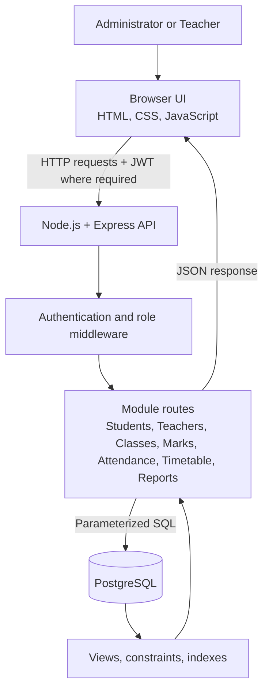
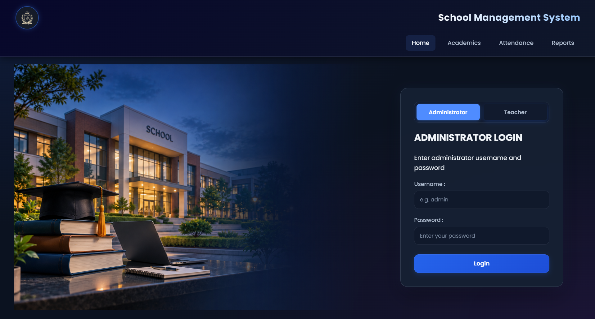
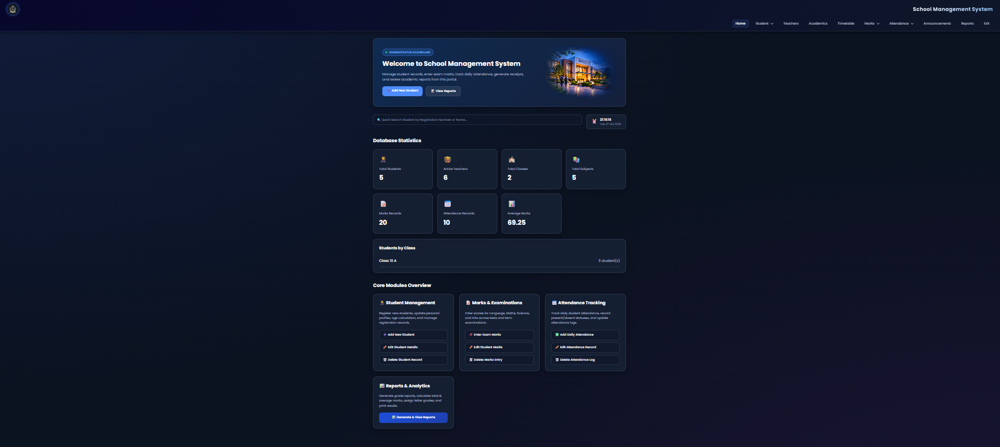
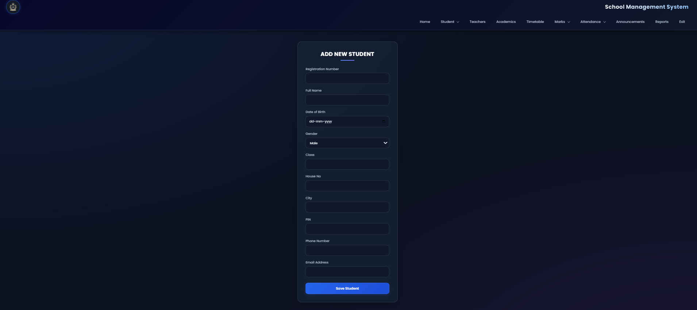
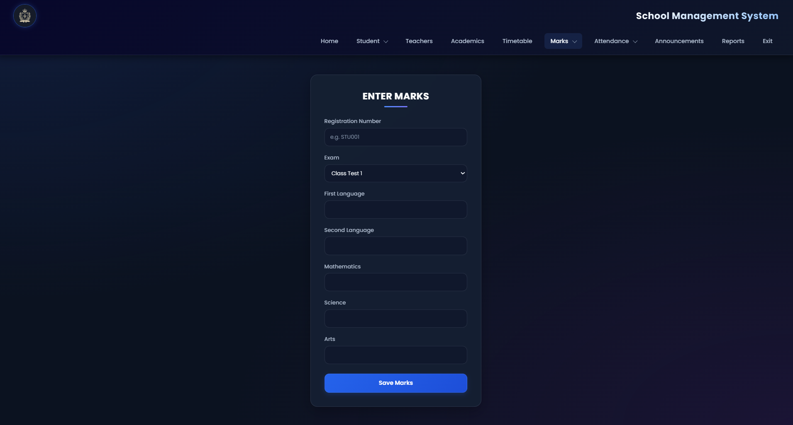
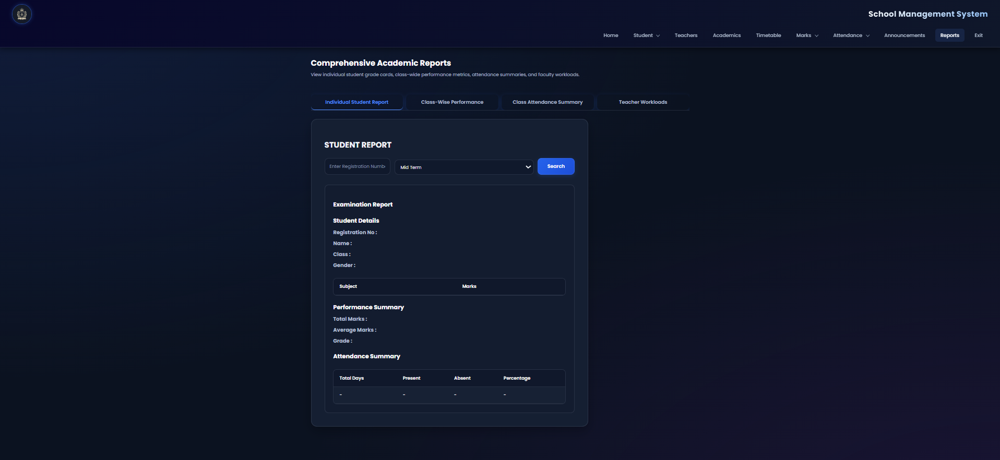

# School Management System

A full-stack school administration application built for a Database Management Systems (DBMS) project. It brings student and teacher records, class and subject setup, timetables, attendance, marks, announcements, and academic reporting into one browser-based system.

The project demonstrates how a relational database, a REST-style Express API, and role-based access control can work together to manage academic records consistently.

<p align="center">
  <a href="https://school-management-system-fc7v.onrender.com/">Live Demo</a> ·
  <a href="https://github.com/karthikeyasa/School-Managment-System">Source Code</a>
</p>

## 1. Project Overview

The School Management System provides separate workflows for administrators and teachers. Administrators manage school records and assignments, while teachers work with the classes and subjects assigned to them. The backend validates requests and stores records in PostgreSQL.

## 2. Features

- **Authentication and permissions:** Administrator and teacher login, bcrypt password verification, JWT sessions, and server-side role checks.
- **Student management:** Add, search, edit, and safely delete student records; search and filter the student directory.
- **Teacher management:** Maintain teacher profiles and account status.
- **Academic setup:** Manage classes, subjects, and teacher-to-class/subject assignments.
- **Timetables:** Create and view weekly schedules, with checks for overlapping class or teacher slots.
- **Marks:** Record and manage subject-wise marks for five core subjects, with exam, academic-year, and attempt information.
- **Attendance:** Record general and subject-specific attendance, including optional timetable-period references.
- **Announcements:** Publish notices with priorities, active status, and target audiences.
- **Reports:** View individual report cards, class performance, attendance summaries, and teacher workload information.
- **Database integrity:** Use primary/foreign keys, unique and check constraints, partial unique indexes, SQL views, and migration/rollback scripts.

## 3. Tech Stack

| Technology | Role in the project |
|---|---|
| HTML5 | Page structure for the administrator and teacher interfaces |
| CSS3 | Shared styling and responsive layouts |
| Vanilla JavaScript | Client-side interactions, API requests, and session handling |
| Node.js | Backend JavaScript runtime |
| Express.js | HTTP server and API route modules |
| PostgreSQL | Relational storage, constraints, joins, aggregations, and views |
| `pg` | PostgreSQL connection pool for the backend |
| `bcryptjs` | Password hashing and verification |
| `jsonwebtoken` | JWT creation and verification |
| `dotenv` | Loading local backend configuration from `.env` |
| Git and GitHub | Version control and project hosting |

## 4. Architecture

The browser-based frontend sends HTTP requests to the Express API. Protected routes validate the JWT and role before performing parameterized SQL queries against PostgreSQL. The API returns JSON for the frontend to display.



## 5. Project Structure

```text
School-Managment-System/
├── index.html                 # Administrator/teacher login portal
├── auth.js                    # Client-side session and API helper
├── dbms.css                   # Shared styles
├── dbms_home.html             # Administrator dashboard
├── teachers.html              # Teacher management
├── classes.html               # Classes, subjects, and assignments
├── timetable.html             # Timetable management
├── announcements.html         # Notices and announcements
├── teacher_dashboard.html     # Teacher dashboard
├── add_student.html           # Student creation
├── edit_student.html          # Student editing
├── delete_student.html        # Student deletion workflow
├── student_search.html        # Student directory and search
├── enter_marks.html           # Marks entry
├── edit_marks.html            # Marks editing
├── delete_marks.html          # Marks deletion
├── add_attendance.html        # Attendance entry
├── edit_attendance.html       # Attendance editing
├── delete_attendance.html     # Attendance deletion
├── reports.html               # Report cards and analytics
├── backend/
│   ├── .env.example           # Environment-variable template
│   ├── db.js                  # PostgreSQL connection pool
│   ├── server.js              # Express server and route registration
│   ├── package.json           # Backend dependencies
│   ├── test_suite.js          # Offline verification tests
│   ├── middleware/auth.js     # JWT and role authorization
│   └── routes/                # Feature-specific API handlers
├── database/
│   ├── schema.sql             # Database schema
│   ├── queries.sql            # SQL examples and demonstrations
│   └── migrations/            # Schema migrations and rollback
└── docs/
    ├── DB-Design.docx         # Database design document
    └── screenshots/           # UI screenshots
```

## 6. Installation & Setup

### Prerequisites

- Node.js 18 or later
- PostgreSQL (the project has been used with PostgreSQL 18)
- Git
- A browser and an editor such as VS Code

### 1. Clone the repository

```bash
git clone https://github.com/karthikeyasa/School-Managment-System.git
cd School-Managment-System
```

### 2. Create and configure the backend environment

```bash
cd backend
npm install
cd ..
```

Copy `backend/.env.example` to `backend/.env` and set values for your local PostgreSQL instance and a strong JWT secret. Example keys (use your own values):

```env
DB_USER=postgres
DB_HOST=localhost
DB_NAME=school_management
DB_PASSWORD=your_local_postgresql_password
DB_PORT=5432
PORT=5000
JWT_SECRET=replace_with_a_long_random_secret
```

Do not commit `.env` or share real credentials. The server refuses to start if `JWT_SECRET` is missing or empty.

### 3. Set up PostgreSQL

Run these database commands from the repository root (the directory containing `database/`). They require PostgreSQL command-line tools (`createdb` and `psql`) to be installed and available on your PATH.

For a **new, empty development database**, create the database and apply the canonical schema from the repository root:

```bash
createdb school_management
psql -d school_management -f database/schema.sql
```

If you are working with an **existing database containing legacy data**, do not blindly run migrations against it. Back it up first, inspect the current schema, and follow the migration instructions in `database/migrations/002_normalize_marks_and_subject_attendance.sql`. The rollback script is provided for the migration path described by the project; test it on a separate database before relying on it.

### 4. Start the backend

From the `backend` directory:

```bash
node server.js
```

The API uses port `5000` by default (or the `PORT` environment variable). The root route should return a JSON health response when the server is running.

### 5. Open the frontend

Open the project root with VS Code and use a local static server (for example, the Live Server extension) to serve `index.html`. Avoid opening the page as a `file://` URL if the browser blocks API requests.

**Local CORS note:** the checked-in `backend/server.js` currently allows the deployed frontend origin. If you serve the frontend locally, add your exact local development origin to the CORS allowlist in `backend/server.js` before testing locally. Do not disable CORS globally in production.

## 7. Usage

1. Open the login page and choose the Administrator or Teacher workflow.
2. Sign in using credentials configured in the database.
3. Administrators maintain teacher profiles, classes, subjects, assignments, timetables, and announcements.
4. Teachers use their dashboard to access assigned classes and subjects, enter marks, record attendance, and view their schedule.
5. Use the Reports section to view student report cards and available class-level summaries.

The repository does not publish default login credentials. Configure test accounts in your own development database rather than putting credentials in the README.

## 8. Screenshots / Demo

**Live demo:** [Open the deployed application](https://school-management-system-fc7v.onrender.com/). The deployment may be unavailable or require a configured backend/database at times.

### Login



### Administrator dashboard



### Student management



### Marks entry and reports





## 9. API Documentation

The backend exposes module routes under `/api`. Protected endpoints require the header `Authorization: Bearer <token>`. Login is public and returns a JWT after valid credentials are checked.

### Authentication

| Method | Endpoint | Auth | Purpose |
|---|---|---|---|
| `POST` | `/api/auth/login` | Public | Authenticate an administrator or teacher |
| `GET` | `/api/auth/me` | Bearer token | Return the authenticated user |

Example login request:

```http
POST /api/auth/login
Content-Type: application/json
```

```json
{
  "username": "your_username_or_teacher_id_or_email",
  "password": "your_password",
  "role": "admin"
}
```

The `role` may be `admin` or `teacher`. The response on success includes a `token` and `user` object. Use the returned token in the `Authorization` header for protected endpoints. Never use real passwords in examples or commit them to source control.

### Main API modules

| Base path | Common methods | Purpose |
|---|---|---|
| `/api/students` | `GET`, `POST`, `PUT`, `DELETE` | Student records |
| `/api/teachers` | `GET`, `POST`, `PUT`, `DELETE` | Teacher records and status |
| `/api/classes` | `GET`, `POST`, `PUT`, `DELETE` | Class management |
| `/api/subjects` | `GET`, `POST`, `PUT`, `DELETE` | Subject catalog |
| `/api/assignments` | `GET`, `POST`, `PUT`, `DELETE` | Teacher/class/subject assignments |
| `/api/timetable` | `GET`, `POST`, `PUT`, `DELETE` | Timetable slots and conflict checks |
| `/api/announcements` | `GET`, `POST`, `PUT`, `DELETE` | School notices |
| `/api/teacher-dashboard` | `GET` | Teacher-scoped dashboard data |
| `/api/marks` | `GET`, `POST`, `PUT`, `DELETE` | Normalized subject marks |
| `/api/attendance` | `GET`, `POST`, `PUT`, `DELETE` | General and subject attendance |
| `/api/reports` | `GET` | Individual reports and class analytics |
| `/api/dashboard` | `GET` | Administrator dashboard statistics; admin token required |

For current route parameters and request-body validation, see the route modules in `backend/routes/`. API responses are JSON; error responses use appropriate HTTP status codes and a message where implemented.

## 10. Engineering Decisions

- **Relational database:** PostgreSQL was selected because academic records have clear relationships and need constraints and consistent transactions.
- **Normalized marks:** `student_subject_marks` stores one row per student, subject, exam, academic year, and attempt. This avoids adding a new database column for each subject and supports retakes.
- **Report view:** `student_reports` derives subject-wise totals, averages, and grades from normalized marks. The current report calculation uses five core subjects and divides the total by `5.0`.
- **Data integrity:** Primary keys, foreign keys, check constraints, composite unique constraints, and partial unique attendance indexes protect against invalid or duplicate records.
- **Role enforcement:** JWT authentication is paired with server-side role and teacher-assignment checks. Client-side navigation controls improve usability but are not the security boundary.
- **Safe migration approach:** SQL migration and rollback scripts document the transition from legacy marks and preserve archived historical data. Run migrations on a backup or test database before production use.
- **Parameterized SQL:** Database values are passed as query parameters instead of being concatenated into SQL strings.

## 11. Testing

Run the offline verification suite from the repository root:

```bash
node backend/test_suite.js
```

The suite is documented as covering authentication helpers, JWT behavior, timetable conflict checks, report calculations, marks-attempt invariants, teacher authorization predicates, attendance uniqueness, and report-sitting invariants. It runs without connecting to PostgreSQL, so it does **not** replace integration testing against a separately configured test database.

Before using the system with real data, also verify login, each role's access restrictions, student CRUD, marks entry and editing, attendance rules, timetable conflict rejection, report calculations, and migration/rollback behavior in a non-production environment.

## 12. Limitations & Future Improvements

- The student record currently stores the class label as text; a `class_id` foreign key would enforce class references at the database level.
- Local development requires the frontend origin to be included in the backend CORS allowlist.
- The offline test suite does not validate live database behavior or every browser workflow; automated integration and end-to-end tests would improve confidence.
- Parent and student portals are not currently included.
- Potential future improvements include password reset and multi-factor authentication, notifications, fee management, exportable PDF/Excel reports, and richer analytics.

## Database Design Document

The database design document is available at [`docs/DB-Design.docx`](docs/DB-Design.docx).

## Team

**Course:** Database Management Systems (DBMS)  
**Program:** S3 B.Tech Computer Science and Engineering  
**Institution:** Amrita School of Computing, Amritapuri Campus

- Karthikeya S Arun
- Ganga J
- Harshita Sanka
